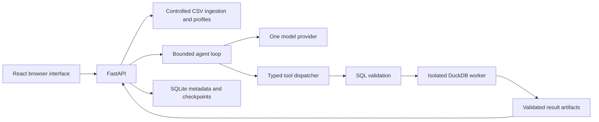

# Architecture and data boundaries

Decision date: November 9, 2026. Status: accepted for the first release.

## Decisions

- Python and FastAPI provide typed HTTP interfaces. Keep application construction in a factory so tests and local configurations do not share accidental global state.
- DuckDB owns analytical calculations; the model proposes queries and explains their executed results. SQLite owns application metadata and checkpoints. Introduce each dependency when its implementation begins.
- React, TypeScript, Vite, and Plotly provide the browser interface. Use a development proxy for relative `/api` requests; the production deployment must route that prefix to the API as well.
- A small explicit agent loop exposes `inspect_schema`, `profile_data`, and `run_sql`. Defer frameworks and additional providers until an actual need appears.
- Treat uploaded files, column names, cell contents, and generated SQL as untrusted input. SQL syntax validation complements an operating-system isolation boundary.
- Store immutable dataset versions and result handles. Findings and charts reference executed result fields instead of invented values.

## Query boundary

Generated SQL will run in a separate, unprivileged worker with no network, no provider credentials, only the relevant database mounted read-only, bounded scratch space, and CPU, memory, time, and output limits. Allow one supported analytical statement and an explicit set of tables and functions. Deny writes, attachments, file scans, extension loading, catalog inspection, and configuration changes. The normal API process must not execute generated SQL before this boundary exists.

Controlled CSV ingestion is a separate path with file-byte, row-count, parse, and storage limits. Cleanup must remove dataset-derived profiles, cached results, and reports.

## Privacy

The local product retains raw datasets locally. The model receives schema, metric definitions, and bounded aggregate results by default. Schema and aggregates can themselves be sensitive, so disclose external processing before enabling the model. Raw examples require explicit user opt-in. Never send credentials, unrelated files, or complete datasets as context.

Use session-scoped ownership checks for datasets, investigations, and artifacts. Production demo uploads are disabled; only synthetic samples are available. Store model keys on the backend, outside version control. Redact raw cells and secrets from application logs.

The activity view shows tools, arguments, validated outputs, and timings. It does not depend on hidden model reasoning.

## Present implementation

Day one provides a health-only API and a frontend that checks its connection. Ingestion, persistence, the model adapter, worker isolation, and analytical tooling are future milestones. There is no execution endpoint or model integration in this skeleton.

## Consequences

One dataset and one provider keep the first release understandable. The isolated worker adds operational overhead but creates a meaningful boundary for generated queries. A frontend/API split requires two development processes and an explicit production routing configuration. Evaluation and evidence integrity are part of product behavior throughout development.

References: [DuckDB security](https://duckdb.org/security), [FastAPI](https://fastapi.tiangolo.com/), [Vite](https://vite.dev/guide/).
