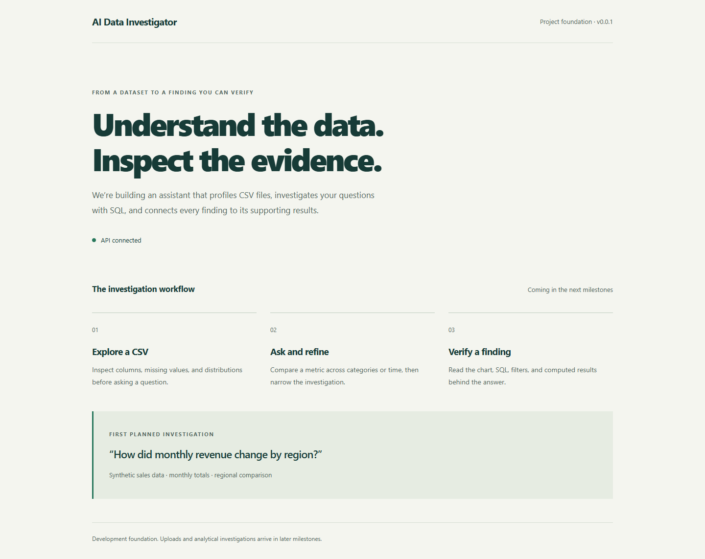

# Delivery progress

## W01 / November 9, 2026

Status: day-one foundation completed and merged through PR #3. Day two continues in a separate branch and PR because the original foundation PR has already been merged.

Completed work packages:

- [x] Product brief and three target user stories.
- [x] MVP acceptance criteria and exclusions.
- [x] Architecture, generated-SQL isolation design, and privacy decisions.
- [x] Runnable FastAPI and React/TypeScript application skeletons with locked dependencies.
- [x] Environment examples, ignored private-data paths, and consistent source formatting.
- [x] Issue forms, PR template, and contribution workflow.
- [x] CI configuration for backend and frontend checks on Windows and Linux.
- [x] Local setup instructions, first-investigation scenario, delivery calendar, and verified screenshots.

## Verification evidence

Verified on Windows with Python 3.13.3 and Node 22.18.0:

- Backend: Ruff lint and formatting, strict mypy, and two bootstrap HTTP tests pass.
- Frontend: Biome lint/format, TypeScript checks, and the Vite production build pass.
- Headless Chrome: the browser connects to the actual API through the Vite development proxy.
- Desktop at 1440 pixels and mobile at 390 pixels render correctly, with no horizontal mobile overflow.
- HTTP failure and an unexpected health payload display the unavailable state; retry restores the connected state.
- No uncaught browser errors or external runtime requests occurred during these checks.

These day-one checks cover the original foundation, before metadata persistence was implemented. Windows/Linux GitHub-hosted checks also passed for that foundation. Ingestion, model integration, SQL execution, and analytical correctness remain later milestones.

[Mobile foundation screenshot](images/foundation-mobile.png)

## W02 / November 10, 2026

Status: implemented on `work/w02-api-persistence`, awaiting owner review and merge. Issue #2 tracks acceptance; it remains open until the Day 2 PR is merged. The earlier foundation merge auto-closed that issue before implementation, so it was reopened.

Completed work packages:

- [x] Typed settings, dotenv/environment precedence, data-path normalization, and redacted backend secret loading.
- [x] Checksummed SQLite migration history, transactional DDL, and schema compatibility validation.
- [x] Validated, immutable dataset metadata with session-scoped lookup and listing.
- [x] Investigation metadata, persisted statuses, and same-session database foreign keys.
- [x] Lifespan-managed initialization and distinct process liveness / metadata readiness contracts.
- [x] Consistent errors, generated request IDs, sanitized validation messages, and preserved HTTP headers.
- [x] Lifecycle checks for application recreation, migration rollback, concurrency, storage loss/locks, and startup failures.
- [x] Contained unexpected request exceptions so their raw details do not escape to the ASGI traceback logger.
- [x] Updated setup, configuration example, API documentation, and source-data ignore rules.

Verification on Windows, Python 3.13.3, and Node 22.18.0:

- **46 backend tests pass**, including persistence across complete application instances, session ownership, invalid inputs, migration failures, and unavailable storage.
- Ruff lint/format and strict application mypy pass.
- Frontend Biome, TypeScript, and production build pass; the existing frontend is unchanged.
- Live HTTP probes verify `/api/health` (200), `/api/ready` (200), and an absent route (404), both directly and through the Vite proxy. Error and header request IDs match.
- The default runtime database is ignored by Git. Tests use isolated temporary directories and no real model credentials or model calls.

GitHub-hosted check results are attached to the Day 2 PR after publication. Approval and merge remain with the repository owner.

This milestone implements internal metadata services, not public dataset/investigation HTTP routes, authentication, CSV ingestion, an analytical worker, or a model provider. The frontend's connected indicator continues to describe process liveness only.

## Next working day: W03 / November 12, 2026

November 11 is Veterans Day and remains a rest day. On Thursday, November 12, create reproducible synthetic sales, support-ticket, and inventory datasets, messy variants, metric definitions, and development/reference questions. Keep held-out evaluation cases separate from development cases as specified in the delivery plan.
